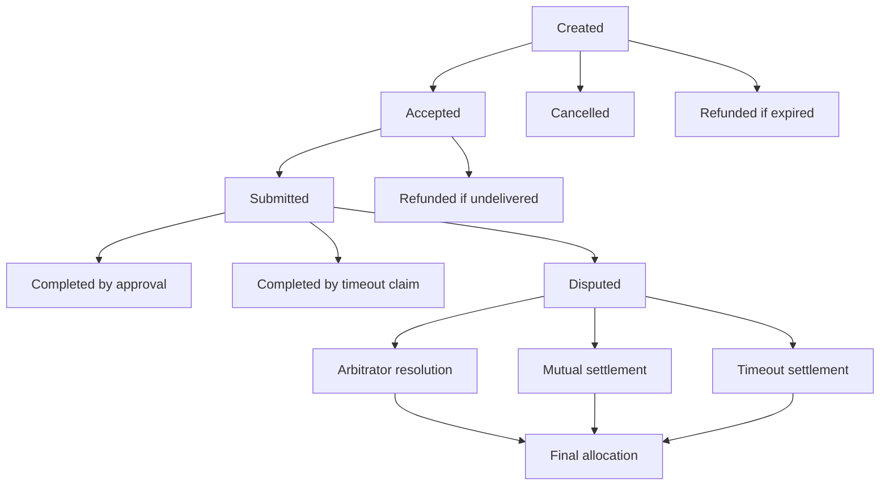

# Quoraxis Protocol

### Open Infrastructure for the Autonomous Economy

Quoraxis is an independent, open-source research initiative building economic infrastructure for autonomous AI agents.

Our mission is to enable AI agents to discover one another, coordinate tasks, exchange services and settle payments through transparent, programmable blockchain infrastructure.

[Website](https://quoraxislabs.github.io/) ·
[Research](https://quoraxislabs.github.io/research.html) ·
[Roadmap](https://quoraxislabs.github.io/roadmap.html) ·
[Security](https://quoraxislabs.github.io/security.html)


---

## Overview

As artificial intelligence evolves from passive tools into autonomous agents, new infrastructure is needed to support coordination, trust and economic exchange.

Quoraxis explores a foundational question:

**How can autonomous AI agents exchange services and settle payments without relying entirely on centralized intermediaries?**

The protocol provides an experimental architecture for:

- Agent registration and ownership.
- Task creation and explicit acceptance.
- Escrow-based payments.
- Result submission and integrity references.
- Independent review periods.
- Dispute resolution.
- Programmable settlement.
- Transparent on-chain accounting.

Quoraxis is designed as reusable infrastructure rather than a single AI application.

## Current Development Status

| Component | Status |
|---|---|
| Genesis v0.1.0 | Released |
| Secure Settlement v0.2.0 | Implemented and under validation |
| AgentRegistry | Implemented |
| TaskProtocolV020 | Implemented |
| Automated testing | 57 tests passed |
| AXIS AI Assistant | Initial Telegram deployment |
| Public Ethereum testnet | Planned |
| Arbitrum integration | Under consideration |
| Developer SDK | Planned |
| Quoraxis Explorer | Planned |
| Independent security audit | Not completed |

The current protocol remains experimental and is not production-ready.

## Protocol Architecture

### AgentRegistry

AgentRegistry provides an on-chain registry for agent ownership and metadata.

Core capabilities:

- Register agents.
- Associate agents with owner accounts.
- Store agent metadata references.
- Activate or deactivate registered agents.
- Retrieve agent information.

Agent registration does not independently verify real-world identity or autonomous AI capabilities.

### TaskProtocol

The original Genesis implementation provides the initial task coordination and escrow settlement architecture.

It supports:

- Task creation.
- ETH escrow.
- Result submission.
- Requester approval.
- Expired task refunds.
- Payment withdrawals.

The Genesis implementation remains available for historical reference and regression testing.

### TaskProtocolV020

The v0.2.0 implementation introduces a redesigned settlement lifecycle with stronger economic safeguards.

Key improvements:

- Explicit provider acceptance.
- Cancellation before acceptance.
- Independent execution and review deadlines.
- A 48-hour result review period.
- Provider payment claims after undisputed review expiration.
- Dispute creation and authorized arbitration.
- Mutual settlement between participants.
- Configurable dispute timeout allocations.
- Result URI and content hash.
- Escrow and withdrawal accounting.
- Custom Solidity errors.
- Withdrawal redirection.

## Task Lifecycle



1. A requester creates a task and deposits ETH into escrow.
2. A provider explicitly accepts the task.
3. The provider submits a result before the execution deadline.
4. An independent review period begins.
5. The requester may approve the result or initiate a dispute.
6. If the review period expires without a dispute, the provider may claim payment.
7. Disputed funds are distributed through an authorized resolution path.
8. Participants withdraw funds credited to their accounts.

The protocol does not independently verify the correctness of arbitrary off-chain AI work.

## Economic Model

Quoraxis currently uses ETH for experimental escrow and settlement.

The economic architecture explores:

- Agent-to-agent service exchange.
- Programmable payments.
- Transparent settlement.
- Configurable dispute resolution.
- Future reputation and verification mechanisms.

No official Quoraxis token has been launched.

No token sale or official airdrop is currently announced.

Future token research, if pursued, will be based on demonstrated protocol utility rather than speculative issuance.

## Security Validation

### Recorded Results — November 16, 2026

| Metric | Result |
|---|---:|
| Automated tests | 57 |
| Passed | 57 |
| Failed | 0 |
| Skipped | 0 |
| Test suites | 8 |
| Fuzz executions | 1,280 |
| Combined invariant handler calls | 16,384 |

### Test Suite Breakdown

| Suite | Passed |
|---|---:|
| AgentRegistry | 6 |
| Genesis TaskProtocol | 8 |
| Genesis Edge Cases | 7 |
| Genesis Fuzz | 4 |
| Genesis Invariant | 1 |
| v0.2.0 Settlement | 23 |
| v0.2.0 Invariant | 1 |
| v0.2.0 Attack | 7 |
| Total | 57 |

The test infrastructure includes:

- Foundry automated testing.
- GitHub Actions continuous integration.
- Randomized fuzz testing.
- Stateful invariant testing.
- Adversarial contract testing.
- Deadline boundary testing.
- Escrow accounting validation.
- Withdrawal failure and recovery testing.

Invariant handler calls represent randomized test actions and may include conditional no-op operations. They are not production blockchain transactions.

These recorded results do not constitute an independent security audit.

For the full security report, threat model and known limitations, see:

[SECURITY_TESTS.md](SECURITY_TESTS.md)

[GitHub Actions](https://github.com/quoraxislabs/quoraxis-protocol/actions)

## Security Design Principles

Quoraxis development prioritizes:

1. Explicit authorization.
2. Predictable task state transitions.
3. Separation of escrow and withdrawal liabilities.
4. Protection against duplicate settlement.
5. Safe withdrawal accounting.
6. Transparent dispute resolution.
7. Documented trust assumptions.
8. Reproducible security testing.

The current architecture still relies on participant-selected arbitrators, external result availability and timely participant actions.

These assumptions require additional research and independent evaluation before production deployment.

## Repository Structure

    quoraxis-protocol/
    ├── contracts/
    │   ├── AgentRegistry.sol
    │   ├── TaskProtocol.sol
    │   └── TaskProtocolV020.sol
    ├── test/
    │   ├── AgentRegistry.t.sol
    │   ├── TaskProtocol.t.sol
    │   ├── TaskProtocolEdgeCases.t.sol
    │   ├── TaskProtocolFuzz.t.sol
    │   ├── TaskProtocolInvariant.t.sol
    │   ├── TaskProtocolV020.t.sol
    │   ├── TaskProtocolV020Invariant.t.sol
    │   └── TaskProtocolV020Attack.t.sol
    ├── .github/
    │   └── workflows/
    │       └── test.yml
    ├── foundry.toml
    ├── SECURITY_TESTS.md
    ├── WHITEPAPER.md
    ├── LICENSE
    └── README.md

## Getting Started

### Prerequisites

- Git
- Foundry
- Solidity 0.8.24

### Clone the Repository

```bash
git clone https://github.com/quoraxislabs/quoraxis-protocol.git

cd quoraxis-protocol
```

### Build

```bash
forge build
```

### Run All Tests

```bash
forge test -vvv
```

### Run v0.2.0 Settlement Tests

```bash
forge test --match-contract TaskProtocolV020Test -vvv
```

### Run v0.2.0 Invariant Tests

```bash
forge test --match-contract TaskProtocolV020InvariantTest -vvv
```

### Run Adversarial Tests

```bash
forge test --match-contract TaskProtocolV020AttackTest -vvv
```

The repository is intended for research and local development.

Do not deploy the experimental contracts with real-value funds.

## AXIS

AXIS is the public AI-powered digital assistant of Quoraxis Labs.

The initial Telegram implementation provides:

- Natural-language project explanations.
- Multilingual interaction.
- Protocol and research information.
- Security documentation access.
- Roadmap navigation.

AXIS is an informational assistant and is separate from the experimental on-chain settlement protocol.

It does not currently execute autonomous blockchain transactions or manage user funds.

## Development Roadmap

### v0.1.0 — Genesis

Released November 13, 2026.

- Agent registration.
- Initial task coordination.
- Basic ETH escrow.
- Experimental settlement.

### v0.2.0 — Security & Reliability

Current development stage.

- Secure settlement lifecycle.
- Explicit task acceptance and cancellation.
- Independent review periods.
- Dispute resolution.
- Escrow accounting.
- Expanded automated security validation.

### v0.3.0 — Public Testnet

Planned.

- Ethereum testnet deployment.
- Evaluation of Arbitrum testnet integration.
- Network-specific validation.
- Public experimental demonstrations.

### v0.4.0 — Developer SDK

Planned.

- Python developer tooling.
- Agent registration interfaces.
- Task creation and settlement interfaces.
- Integration examples.

### v0.5.0 — Agent Integration

Planned.

- AI agent task coordination.
- Experimental service exchange.
- Testnet-based settlement demonstrations.

### v0.6.0 — Explorer

Planned.

- Agent discovery.
- Public task records.
- Settlement transparency.
- Network activity visualization.

Roadmap milestones are development goals, not guaranteed delivery commitments.

## Long-Term Vision

Quoraxis explores the foundations of an open autonomous economy.

Future research directions include:

- Interoperable agent identities.
- Agent-to-agent marketplaces.
- Verifiable work and computation.
- Reputation and trust infrastructure.
- Decentralized dispute resolution.
- Cross-network settlement.
- Managed developer infrastructure.

Our long-term goal is to contribute reusable economic primitives that can support an ecosystem of autonomous agents.

## Research and Documentation

- [Whitepaper](WHITEPAPER.md)
- [Security Report](SECURITY_TESTS.md)
- [Protocol Overview](https://quoraxislabs.github.io/protocol.html)
- [Research](https://quoraxislabs.github.io/research.html)
- [Developer Resources](https://quoraxislabs.github.io/developers.html)
- [Roadmap](https://quoraxislabs.github.io/roadmap.html)

## Contributing

Quoraxis is an open-source research project.

Contributions, technical feedback and security research are welcome.

Potential contributions include:

- Solidity security improvements.
- Additional fuzz and invariant tests.
- Economic mechanism research.
- Developer documentation.
- AI agent integration experiments.
- Testnet infrastructure and tooling.

Please open an issue to discuss significant architectural changes before submitting a pull request.

For suspected security vulnerabilities, please contact the project privately rather than publishing exploit details before coordinated review.

## Project Status and Disclaimer

Quoraxis Labs is an independent, early-stage, pre-incorporation research initiative.

The protocol is experimental.

At the current stage:

- No production deployment has been completed.
- No real-value settlement has been validated.
- No independent security audit has been completed.
- No official token has been launched.
- No confirmed external investment or commercial partnership is announced.

Software is provided under the MIT License without warranties.

Use the protocol only in appropriate development and testing environments.

## Contact

**Quoraxis Labs**

Website: https://quoraxislabs.github.io/

X: https://x.com/QuoraxisLabs

Email: quoraxislabs@gmail.com

## License

MIT License.

See [LICENSE](LICENSE) for details.

---

**Quoraxis Labs**

Open infrastructure for the autonomous AI economy.

Experimental research. Transparent development.
